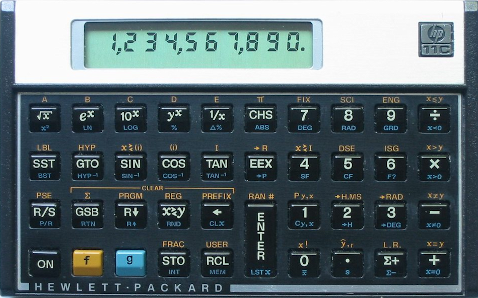

# HP-11C — functional reimplementation and ROM verification

A browser reimplementation of the HP-11C scientific programmable calculator,
an implementation specification, and a differential test suite that checks the
reimplementation against the **original HP-11C firmware** running on
[Nonpareil](https://github.com/brouhaha/nonpareil)'s Nut/Voyager CPU core.

The calculator UI is pure HTML/CSS/JavaScript.  The verification tools are C
and Python and are optional.



## Features

- Faithful RPN four-level stack, LAST X, `R0..R9`, `R.0..R.9`, and Index
  register I.
- All HP-11C keys and shifted functions: math, logs, trig (DEG/RAD/GRAD),
  hyperbolics, `->P/->R`, `->HMS/->H`, `%`/`Δ%`, probability, statistics
  (`Σ`, mean, `s`, `L.R.`, `y,r`, `RCL Σ+`), random numbers, flags, indirect
  addressing, `ISG`/`DSE`.
- Program entry/editing/execution, labels, subroutines, loops, `PSE`, `R/S`,
  memory allocation (63→203 lines) and `MEM`.
- Display modes FIX/SCI/ENG, exact HP digit grouping and separators, decimal
  point/comma radix conventions, annunciators, error messages and program-line
  formatting.
- A physical LCD renderer calibrated to the reference calculator image.

## Quick start (JS GUI)

From the repository root:

```sh
python3 -m http.server 8000
# open http://localhost:8000/hp11c.html
```

A local server is recommended (browsers restrict local image loading under
`file://`).  The app has no build step.

If GitHub Pages is enabled for the repository (**Settings → Pages → Source:
GitHub Actions**), the `Pages` workflow publishes the app at
<https://jspx-projects.github.io/hp11c/> on every push to `main`.  The root
`index.html` redirects to `hp11c.html`.

## Repository layout

```
hp11c.html            calculator page
hp11c-engine.js       DOM-free calculator engine
hp11c-view.js         SVG LCD/keyboard view
HP11c_image.png       reference calculator face
doc/Specification.txt implementation specification
verify/               differential verification suite (optional; see below)
LICENSE               GPL-3.0
```

## Verification suite

`verify/` runs the same keystrokes on the original ROM and on `hp11c-engine.js`
and compares the LCD glyph-for-glyph.

Current result: **308/310 cases pass**, with **86.1% of the ROM image
executed** by the suite.  The only two differences are the random-number
sequence; `Specification.txt` §14.2 explicitly permits a substitute generator.
Details and the full findings history are in `verify/AUDIT.md`.

The suite does **not** include the HP-11C ROM or Nonpareil.  One command fetches
both (the pinned Nonpareil checkout contains the HP-11C ROM), applies the
optional fast/coverage patch, and builds:

```sh
make -C verify deps
python3 verify/audit.py --fast          # ~3 minutes
python3 verify/audit.py --fast --cov    # also report ROM coverage
```

The ROM is HP firmware; Nonpareil distributes `ncd/11c/11c.rom` under
CC BY-SA 2.5.  If you prefer your own dump, replace it in
`nonpareil/ncd/11c/` before the build.  Manual steps and options
(`--no-patch`, `--no-build`, `--dest`) are in `verify/README.md`.

The ROM is HP firmware; Nonpareil distributes `ncd/11c/11c.rom` under
CC BY-SA 2.5.  If you prefer your own dump, substitute it before building.

See `verify/README.md` for the headless simulator protocol, the ROM-backed GUI
(`python3 verify/bridge.py`), fast mode, and coverage instrumentation.

## Status and confidence

The functional areas exercised by the suite match the ROM exactly: stack and
LAST X, arithmetic, logs/trig/hyperbolics, statistics, storage and indirect
addressing, flags, program recording for every programmable key, editing,
program execution, memory allocation/Error 3, display formatting and
separators, and error layouts.  Hardware-service paths (power-on self-tests,
low-battery sensing, auto-off, the physical key-scan matrix, display refresh
timing, Continuous Memory persistence across power loss) are deliberately out
of scope and are documented in `Specification.txt` §29.  The GUI's low-battery
checkbox is a display test, not a battery measurement.

## License

This project is licensed under the **GNU General Public License, version 3**
(see `LICENSE`).

Not included and separately licensed:

- **Nonpareil** (Eric Smith), GPL, <https://github.com/brouhaha/nonpareil>.
  The verification suite links against it; clone it separately as above.
- **HP-11C ROM/firmware**: HP copyright; obtain it from Nonpareil's model
  directory or your own calculator.  It is not redistributed here.
- The HP-11C owner's manuals are not redistributed here; `Specification.txt`
  is an original document derived from them.

HP-11C is a trademark of Hewlett-Packard.  This project is not affiliated with
or endorsed by HP.  The calculator face image is included as the reference for
the renderer; replace it if you do not hold the rights to it.
